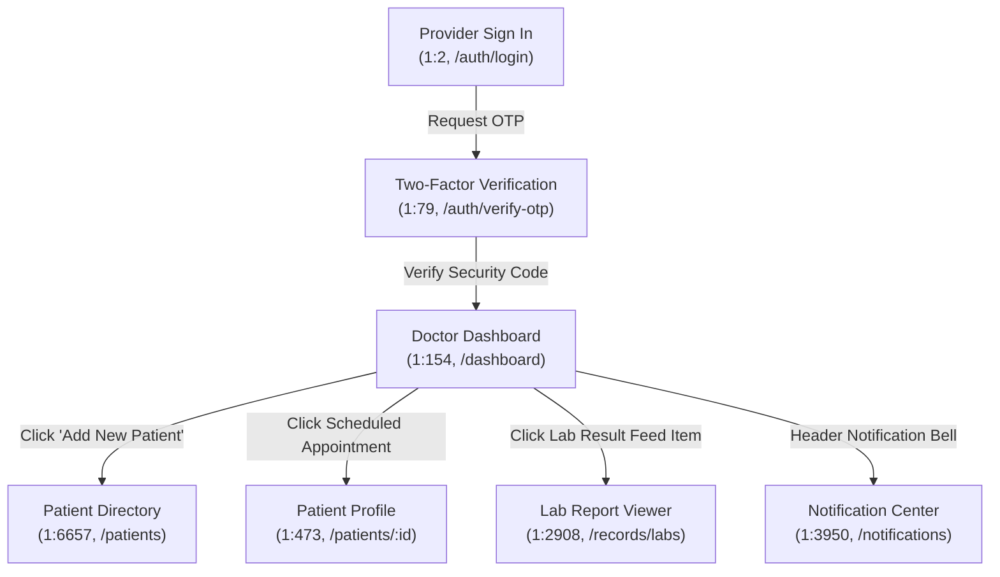
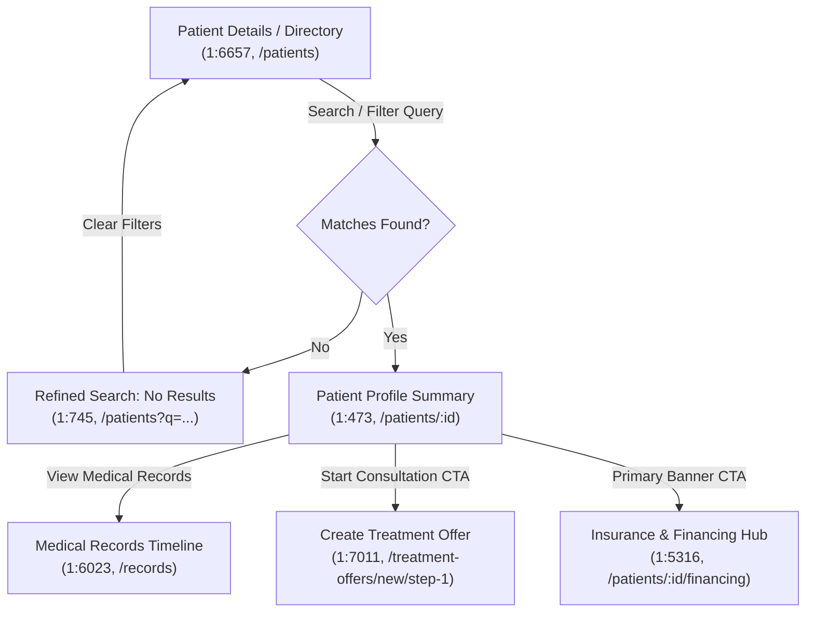
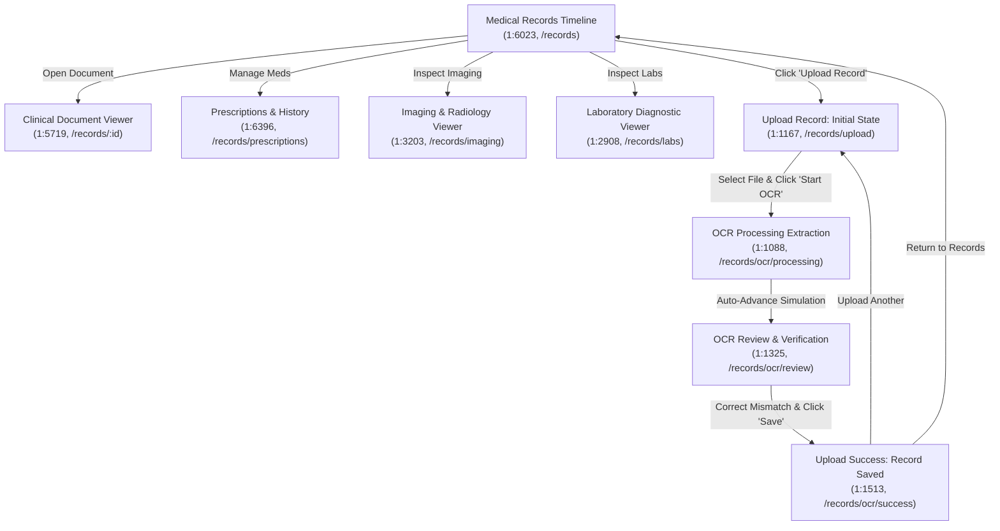
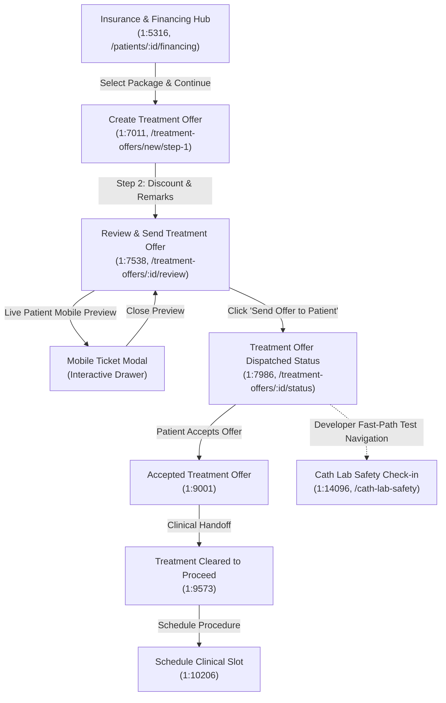
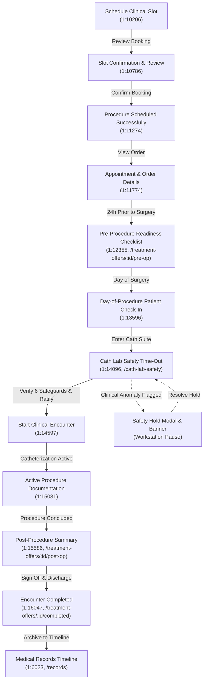
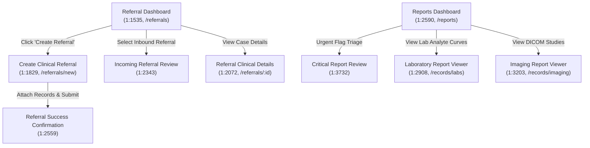

# Doctor-Web: Master Development Roadmap

---

## 1. Doctor-Web Project Overview

### 1.1 Project Mission & Architectural Objective
**Doctor-Web** is an enterprise-grade clinical web application designed for healthcare providers, attending physicians, and surgical teams within the CareID digital health ecosystem. The application unites outpatient scheduling, patient records triage, neural OCR document ingestion, clinical underwriting & financing comparisons, treatment offer authoring, surgical pre-operative checklists, Cath Lab intra-procedure safety time-outs, and post-procedure encounter documentation into a single, cohesive workflow.

### 1.2 Technology Toolchain & Standards
- **Framework & Runtime**: React 18.3.1, TypeScript 5.7.3 (strict mode), Vite 6.1.0
- **Styling & Design System**: Tailwind CSS 3.4.17, PostCSS 8.5.2, Plus Jakarta Sans typography
- **Routing Infrastructure**: React Router DOM v6.28.2 (`createBrowserRouter` declarative architecture)
- **Component Icons & Visuals**: Lucide React v0.475.0, authentic CareID medical graphics and photography
- **Quality Gates**: `npm run type-check` (`tsc -b --noEmit`), `npm run lint` (`eslint .`), `npm run build` (`vite build`)
- **Testing & Verification**: Headless Chromium via Playwright, subpixel DOM measurement, visual artifact diffing

### 1.3 Git Baseline & Repository Integrity
- **Current Baseline HEAD**: `83014b7` (`feat: checkpoint financing, treatment offers, and cath lab workflow`)
- **Working Tree Discipline**: Milestone 9 (OCR Medical Document Processing Pipeline), Milestone 10 (Clinical Handoff, Scheduling & Pre-Op Workflow - Path B), and Milestone 11 (Surgical Encounter Completion & Terminal Procedure Lifecycle) implementation changes and documentation updates are preserved in the active working tree with zero unauthorized Git write operations (no commits, no pushes, no resets).

### 1.4 Purpose of this Roadmap
This document serves as the authoritative, permanent **Master Development Roadmap** for Doctor-Web. It reconciles every single frame across the connected CareID Figma canvas (`0:1`), catalogs real registered routes, traces end-to-end clinical doctor workflows, details implementation statuses, establishes strict duplicate/draft exclusion boundaries, and prioritizes remaining production modules. Detailed historical execution logs are maintained in [`implementation.md`](file:///s:/PROJECTS_CODEXDOT/doctor-web-frontend/implementation.md), while the visual fidelity contract is preserved in [`design.md`](file:///s:/PROJECTS_CODEXDOT/doctor-web-frontend/design.md).

---

## 2. Complete Figma Production Inventory

The connected CareID Figma document (`Doctror_web`, canvas root `0:1`) contains exactly **50 direct canvas children**:
- **48 Frame Elements**: 46 production candidates (45 visible on canvas + 1 hidden production frame `1:16047`) and 2 exploratory drafts (`1:12893`, `1:13265`).
- **2 Standalone Brand Assets**: Standalone rounded-rectangle vector brand marks (`1:153`, `1:472`).

### 2.1 Mathematical Inventory Reconciliation
$$\begin{aligned}
\text{Total Canvas Elements} &= 50 \\
&= 48 \text{ Frames} + 2 \text{ Standalone Brand Assets} \\
&= [46 \text{ Production Candidates} + 2 \text{ Exploratory Drafts}] + 2 \text{ Standalone Brand Assets}
\end{aligned}$$

The **46 Production Candidates** are strictly categorized as follows:
1. **Dedicated Pages**: **36 frames** (Independent full-page clinical views requiring dedicated route handlers)
2. **Workflow States / Modals**: **6 frames** (`1:1088` OCR Processing, `1:1513` Upload Success, `1:9001` Accepted Offer, `1:10786` Slot Confirmation, `1:11274` Procedure Scheduled, `1:2559` Referral Success)
3. **Interactive Variants**: **1 frame** (`1:745` Search No Results empty state)
4. **Duplicates / Component Reuses**: **2 frames** (`1:882` Radiology Navigation Duplicate, `1:8548` Treatment Offer Lifecycle Stepper)
5. **Hidden Production Frames**: **1 frame** (`1:16047` Encounter Completed, `hidden="true"`)
$$\text{Sum of Production Candidates} = 36 + 6 + 1 + 2 + 1 = 46$$

*(Note on previous discrepancy: Earlier preliminary summaries cited "39 dedicated pages + 4 workflow states + 2 duplicates = 45". That un-reconciled estimate omitted the hidden frame and conflated intermediate workflow states with dedicated pages. The above 36 + 6 + 1 + 2 + 1 = 46 breakdown represents the verified, node-by-node ground truth).*

### 2.2 Complete Canvas Mapping Table
Every canvas element has been audited, verified, and mapped below:

| No. | Module | User-Facing Page Name | Figma Frame Name | Figma Node ID | Application URL | Component | Classification | Status |
| :--- | :--- | :--- | :--- | :--- | :--- | :--- | :--- | :--- |
| **01** | Authentication | Provider Sign In | `Doctor Web Portal - Refined Secure Login` | `1:2` | `/auth/login` (Registered) | `AuthPlaceholder.tsx` | Dedicated Page | Partially Implemented (UI Shell Active; Auth Backend Deferred) |
| **02** | Authentication | Two-Factor Authentication | `Otp` | `1:79` | `/auth/verify-otp` (Registered) | `AuthPlaceholder.tsx` | Dedicated Page | Partially Implemented (UI Shell Active; Auth Backend Deferred) |
| **03** | Core Shell | CareID Portal Brand Asset | `CareIDlogo 1` | `1:153` | Not Required | `Logo.tsx` | Standalone Asset | Accepted (Exported SVG / Canvas Asset) |
| **04** | Core Shell | CareID Header Brand Mark | `CareIDlogo 2` | `1:472` | Not Required | `Logo.tsx` | Standalone Asset | Accepted (Exported SVG / Canvas Asset) |
| **05** | Dashboard | Clinical Dashboard | `Dashboard` | `1:154` | `/dashboard` (Registered) | `DashboardPage.tsx` | Dedicated Page | Accepted |
| **06** | Patients | Patient Details | `Patient` | `1:6657` | `/patients` (Registered) | `PatientDirectoryPage.tsx` | Dedicated Page | Accepted |
| **07** | Patients | Search: No Results | `Doctor Web Portal - Refined Search: No Results` | `1:745` | `/patients?q=...` (Registered) | `PatientDirectoryPage.tsx` | Interactive Variant | Accepted (Integrated Empty State) |
| **08** | Patients | Patient Profile Summary | `Doctor Web Portal - Grouped Navigation (Patient Profile)` | `1:473` | `/patients/:id` (Registered) | `PatientProfilePage.tsx` | Dedicated Page | Accepted |
| **09** | Medical Records | Medical Records Timeline | `Doctor Web Portal - Refined Navigation (Medical Records)` | `1:6023` | `/records` (Registered) | `MedicalRecordsPage.tsx` | Dedicated Page | Accepted |
| **10** | Medical Records | Clinical Document Viewer | `Doctor Web Portal - Document Viewer (Refined)` | `1:5719` | `/records/:id` (Registered) | `RecordDetailPage.tsx` | Dedicated Page | Accepted |
| **11** | Medical Records | Prescription & Clinical History | `Doctor Web Portal - Prescription & Clinical History (Refined)` | `1:6396` | `/records/prescriptions` (Registered) | `PrescriptionsPage.tsx` | Dedicated Page | Accepted |
| **12** | Diagnostics | Imaging Report Viewer | `Doctor Web Portal - Imaging Report Viewer` | `1:3203` | `/records/imaging` (Registered) | `RadiologyViewerPage.tsx` | Dedicated Page | Accepted |
| **13** | Diagnostics | Radiology Review Navigation | `Doctor Web Portal - Grouped Navigation (Radiology Review)` | `1:882` | `/records/imaging` (Registered) | `RadiologyViewerPage.tsx` | Duplicate | Duplicate — Reuse Existing (`1:3203`) |
| **14** | Diagnostics | Laboratory Report Viewer | `Doctor Web Portal - Laboratory Report Viewer` | `1:2908` | `/records/labs` (Registered) | `LabReportPage.tsx` | Dedicated Page | Accepted |
| **15** | OCR Pipeline | Upload Health Record | `Upload Medical Record - Initial State` | `1:1167` | `/records/upload` (Registered) | `MedicalRecordUploadPage.tsx` | Dedicated Page | Implemented — Awaiting Review |
| **16** | OCR Pipeline | OCR Data Extraction | `OCR Processing - Data Extraction` | `1:1088` | `/records/ocr/processing` (Internal State) | `MedicalRecordUploadPage.tsx` | Workflow State | Implemented — Awaiting Review |
| **17** | OCR Pipeline | OCR Review & Field Verification | `OCR Review & Field Verification` | `1:1325` | `/records/ocr/review` (Registered) | `MedicalRecordUploadPage.tsx` | Dedicated Page | Implemented — Awaiting Review |
| **18** | OCR Pipeline | Health Record Saved | `Upload Success - Record Saved` | `1:1513` | `/records/ocr/success` (Internal State) | `MedicalRecordUploadPage.tsx` | Workflow State | Implemented — Awaiting Review |
| **19** | Financing | Insurance & Financing Hub | `Care ID Doctor - Financing Options & Comparison` | `1:5316` | `/patients/:id/financing` (Registered) | `InsuranceFinancingHubPage.tsx` | Dedicated Page | Implemented — Awaiting Review (Pending UX Optimization) |
| **20** | Treatment Offers | Create Treatment Offer | `Create Treatment Offer` | `1:7011` | `/treatment-offers/new/step-1` (Registered) | `TreatmentOfferCreatePage.tsx` | Dedicated Page | Implemented — Awaiting Review (Pending UX Optimization) |
| **21** | Treatment Offers | Review & Send Treatment Offer | `Care ID Doctor - Review & Send Treatment Offer` | `1:7538` | `/treatment-offers/:id/review` (Registered) | `TreatmentOfferReviewPage.tsx` | Dedicated Page | Implemented — Awaiting Review |
| **22** | Treatment Offers | Treatment Offer Dispatched Status | `offer status` | `1:7986` | `/treatment-offers/:id/status` (Registered) | `TreatmentOfferStatusPage.tsx` | Dedicated Page | Implemented — Awaiting Review |
| **23** | Treatment Offers | Treatment Offer Lifecycle Tracker | `Treatment offer lifecycle` | `1:8548` | `/treatment-offers/:id/in-progress` (Registered) | `TreatmentOfferStatusPage.tsx` | Duplicate | Duplicate — Reuse Existing (`1:7986` Stepper) |
| **24** | Treatment Offers | Accepted Treatment Offer | `Care ID Doctor - Accepted Treatment Offer` | `1:9001` | `/treatment-offers/:id/accepted` (Registered) | `TreatmentOfferAcceptedPage.tsx` | Dedicated Page | Implemented — Awaiting Review |
| **25** | Procedure Workflow | Clinical Handoff & Clearance | `Care ID Doctor - Treatment Cleared to Proceed (Clinical Handoff)` | `1:9573` | `/treatment-offers/:id/clearance` (Registered) | `ClinicalHandoffPage.tsx` | Dedicated Page | Implemented — Awaiting Review |
| **26** | Procedure Workflow | Schedule Clinical Slot | `Care ID Doctor - Schedule Clinical Slot` | `1:10206` | `/treatment-offers/:id/schedule` (Registered) | `ProcedureSchedulingPage.tsx` (Select Mode) | Dedicated Page | Implemented — Awaiting Review |
| **27** | Procedure Workflow | Slot Confirmation & Review | `Care ID Doctor - Slot Confirmation & Final Review` | `1:10786` | `/treatment-offers/:id/schedule/review` (Registered) | `ProcedureSchedulingPage.tsx` (Review Mode) | Workflow State | Implemented — Awaiting Review |
| **28** | Procedure Workflow | Procedure Scheduled Confirmation | `Care ID Doctor - Procedure Scheduled Successfully` | `1:11274` | `/treatment-offers/:id/scheduled` (Registered) | `ProcedureSchedulingPage.tsx` (Confirmed Mode) | Workflow State | Implemented — Awaiting Review |
| **29** | Procedure Workflow | Appointment Details & Orders | `Care ID Doctor - Scheduled Procedure & Appointment Details` | `1:11774` | `/treatment-offers/:id/appointment` (Registered) | `AppointmentDetailsPage.tsx` | Dedicated Page | Implemented — Awaiting Review |
| **30** | Procedure Workflow | Pre-Procedure Readiness Checklist | `Care ID Doctor - Pre-Procedure Readiness Checklist` | `1:12355` | `/treatment-offers/:id/pre-op` (Registered) | `PreOpReadinessPage.tsx` | Dedicated Page | Implemented — Awaiting Review |
| **31** | Cath Lab | Day-of-Procedure Patient Check-In | `Care ID Doctor - Day-of-Procedure Check-In` | `1:13596` | `/treatment-offers/:id/check-in` (Registered) | `DayOfCheckinPage.tsx` | Dedicated Page | Implemented — Awaiting Review |
| **32** | Cath Lab | Cath Lab Clinical Time-Out | `Care ID Doctor - Patient & Clinical Safety Verification` | `1:14096` | `/cath-lab-safety` (Registered) | `CathLabSafetyCheckinPage.tsx` | Dedicated Page | Implemented — Awaiting Review (Pending UX Optimization) |
| **33** | Cath Lab | Start Clinical Encounter | `Care ID Doctor - Start Clinical Encounter` | `1:14597` | `/treatment-offers/:id/encounter/start` (Registered) | `StartClinicalEncounterPage.tsx` | Dedicated Page | Implemented — Awaiting Review |
| **34** | Cath Lab | Active Procedure Documentation | `Care ID Doctor - Active Procedure Documentation` | `1:15031` | `/treatment-offers/:id/encounter/active` (Registered) | `ActiveProcedureDocumentationPage.tsx` | Dedicated Page | Implemented — Awaiting Review |
| **35** | Cath Lab | Post-Procedure Clinical Summary | `Care ID Doctor - Post-Procedure Summary` | `1:15586` | `/treatment-offers/:id/post-op` (Registered) | `PostProcedureSummaryPage.tsx` | Dedicated Page | Implemented — Awaiting Review |
| **36** | Cath Lab | Encounter Completed & Sign-Off | `Care ID Doctor - Encounter Completed` | `1:16047` | `/treatment-offers/:id/completed` (Registered) | `EncounterCompletedPage.tsx` | Hidden Production Frame | Implemented — Awaiting Review (Authorized Inclusion) |
| **37** | Referrals | Referral Management Dashboard | `Doctor Web Portal - Referral Dashboard` | `1:1535` | `/referrals` (Registered) | Not Implemented | Dedicated Page | Missing |
| **38** | Referrals | Create Clinical Referral | `Doctor Web Portal - Create Referral` | `1:1829` | `/referrals/new` (Registered) | Not Implemented | Dedicated Page | Missing |
| **39** | Referrals | Referral Clinical Details | `Doctor Web Portal - Referral Details` | `1:2072` | `/referrals/:id` (Registered) | Not Implemented | Dedicated Page | Missing |
| **40** | Referrals | Incoming Referral Triage | `Doctor Web Portal - Incoming Referral Review` | `1:2343` | Proposed (`/referrals/incoming/:id`) | Not Implemented | Dedicated Page | Missing |
| **41** | Referrals | Referral Dispatched Confirmation | `Doctor Web Portal - Referral Success` | `1:2559` | Proposed (`/referrals/success`) | Not Implemented | Workflow State | Missing |
| **42** | Reports | Diagnostic Reports Dashboard | `Doctor Web Portal - Reports Dashboard` | `1:2590` | `/reports` (Registered) | Not Implemented | Dedicated Page | Missing |
| **43** | Reports | Critical Diagnostic Alert Review | `Doctor Web Portal - Critical Report Review` | `1:3732` | Proposed (`/reports/critical/:id`) | Not Implemented | Dedicated Page | Missing |
| **44** | Notifications | Clinician Notification Center | `Notification Center` | `1:3950` | `/notifications` (Registered) | Not Implemented | Dedicated Page | Missing |
| **45** | Profile & Settings | Clinician Professional Profile | `Doctor Web Portal - Professional Profile` | `1:4281` | `/settings` (Registered) | Not Implemented | Dedicated Page | Missing |
| **46** | Profile & Settings | Account & Security Settings | `Doctor Web Portal - Account & Security Settings` | `1:4531` | `/settings/security` (Registered) | Not Implemented | Dedicated Page | Missing |
| **47** | Profile & Settings | Notification Preferences | `Doctor Web Portal - Notification Preferences` | `1:4834` | Proposed (`/settings/notifications`) | Not Implemented | Dedicated Page | Missing |
| **48** | Profile & Settings | Clinical Support & Help Desk | `Doctor Web Portal - Support & Help Center` | `1:5113` | Proposed (`/settings/support`) | Not Implemented | Dedicated Page | Missing |
| **49** | Exploratory Draft | Medical Records Early Concept | `Doctor Web Portal - Medical Records` | `1:12893` | Not Required | None | Exploratory Draft | Excluded Draft (1576px wide exploratory concept) |
| **50** | Exploratory Draft | OCR Scanning Early Concept | `Doctor Web Portal - Medical Records` | `1:13265` | Not Required | None | Exploratory Draft | Excluded Draft (1576px wide exploratory concept) |

---

## 3. User Workflow Maps

The CareID application is organized around how healthcare providers interact with clinical data, make diagnostic evaluations, negotiate surgical financing, and execute intra-procedure safety verifications. Below are the verified workflow graphs:

### 3.1 Workflow A: Doctor Access, Authentication & Daily Triage
Providers authenticate with multi-factor biometric/OTP verification and enter the centralized clinical dashboard.

---

### 3.2 Workflow B: Patient Management & Clinical Profiling
From the master patient list, clinicians search, filter by demographic risk, and access comprehensive longitudinal charts.

---

### 3.3 Workflow C: Medical Records & Diagnostic Ingestion Pipeline
Clinicians inspect historical diagnostics and upload physical medical reports into the neural OCR pipeline.

---

### 3.4 Workflow D: Treatment Offer Creation, Financing & Status Lifecycle
From financing packages to offer dispatch and patient mobile tracking.

#### 3.4.1 The Complete 12-Stage Treatment-to-Procedure Lifecycle
The table below details the authentic 12-step chronological progression connecting treatment proposal generation to surgical execution:

| Step | Figma Node ID | Figma Frame Name | Stage Name | Clinical Purpose & Transition Trigger | Implementation Status |
| :---: | :---: | :--- | :--- | :--- | :--- |
| **01** | `1:7011` | `Create Treatment Offer` | Offer Configuration | Clinician configures clinical package, financing tier, and deposit terms. | Implemented (`TreatmentOfferCreatePage.tsx`) |
| **02** | `1:7538` | `Care ID Doctor - Review & Send Treatment Offer` | Offer Final Review | Clinician verifies terms and previews mobile patient delivery. | Implemented (`TreatmentOfferReviewPage.tsx`) |
| **03** | `1:7986` | `offer status` | Offer Dispatched | Real-time dispatch tracking; awaiting patient digital signature. | Implemented (`TreatmentOfferStatusPage.tsx`) |
| **04** | `1:9001` | `Care ID Doctor - Accepted Treatment Offer` | Offer Accepted | Patient signs financial contract and Care ID installment terms. | Implemented (`TreatmentOfferAcceptedPage.tsx`) |
| **05** | `1:9573` | `Care ID Doctor - Treatment Cleared to Proceed (Clinical Handoff)` | Multi-Disciplinary Clearance | Cardiology, Anesthesia, and Nursing sign-offs prior to suite booking. | Implemented (`ClinicalHandoffPage.tsx`) |
| **06** | `1:10206` | `Care ID Doctor - Schedule Clinical Slot` | OR / Cath Suite Booking | Scheduling theater slot, surgical equipment, and clinical team. | Implemented (`ProcedureSchedulingPage.tsx`) |
| **07** | `1:10786` | `Care ID Doctor - Slot Confirmation & Final Review` | Team & Staffing Confirmation | Final calendar lock-in and anesthesia team notification. | Implemented (`ProcedureSchedulingPage.tsx`) |
| **08** | `1:11274` | `Care ID Doctor - Procedure Scheduled Successfully` | Booking Confirmed | Electronic order generation and patient notification dispatched. | Implemented (`ProcedureSchedulingPage.tsx`) |
| **09** | `1:11774` | `Care ID Doctor - Scheduled Procedure & Appointment Details` | Appointment Orders & Prep | Clinical pre-procedure prep instructions and medication hold orders. | Implemented (`AppointmentDetailsPage.tsx`) |
| **10** | `1:12355` | `Care ID Doctor - Pre-Procedure Readiness Checklist` | 24h Pre-Op Readiness | Fasting (NPO) verification, coagulation labs, and surgical consents. | Implemented (`PreOpReadinessPage.tsx`) |
| **11** | `1:13596` | `Care ID Doctor - Day-of-Procedure Check-In` | Holding Bay Admission | Patient arrival, barcode wristband scan, and baseline vitals triage. | Implemented (`DayOfCheckinPage.tsx`) |
| **12** | `1:14096` | `Care ID Doctor - Patient & Clinical Safety Verification` | Cath Lab Time-Out | Intra-procedure WHO surgical checklist and cryptographic safety ratification. | Implemented (`CathLabSafetyCheckinPage.tsx`) |

> [!IMPORTANT]
> **Architectural Distinction: Clinical Sequence vs. Developer Fast-Path**
> - **Clinical Reality**: In a live clinical EHR, a patient cannot skip from a freshly dispatched offer (`1:7986`) directly into the Cath Lab operating suite (`1:14096`) without patient financial acceptance, multi-specialty clearance, theater scheduling, and pre-op fasting checks.
> - **Developer Fast-Path**: To enable parallel development and immediate functional testing of the high-stakes Cath Lab safety workstation (Milestone 8) without blocking on 8 intermediate scheduling/clearance screens, an explicit shortcut CTA ("Cath Lab Intra-Procedure Safety Check-in") was wired into `TreatmentOfferStatusPage.tsx`. When Groups A and B are fully implemented, this button will transition into its permanent conditional role (e.g., active only once pre-op check-in is complete).

---

### 3.5 Workflow E: Surgical Pre-Op, Cath Lab Time-Out & Encounter Completion
The complete peri-operative procedure journey from surgical booking to discharge sign-off.

---

### 3.6 Workflow F: Clinical Referrals, Consultations & Reporting
Cross-facility specialist collaboration and diagnostic reports management.

---

## 4. Page Dependency and Navigation Matrix

The table below defines what precedes and follows every screen, establishing explicit entry points, primary in-page triggers, and exit routes:

| User-Facing Page (Node ID) | Ingress / Entry Points (Where doctor comes from) | Primary In-Page Decisions / Controls / CTAs | Egress / Next Pages (Where doctor goes next) | Return / Back Navigation | Contextual / Branching Actions |
| :--- | :--- | :--- | :--- | :--- | :--- |
| **Provider Sign In** (`1:2`) | Root url (`/`), session logout | Phone / ID input, "Request OTP" CTA | Two-Factor Auth (`1:79`) | N/A (Root) | Forgot Password, Help Desk |
| **Two-Factor Auth** (`1:79`) | Provider Sign In (`1:2`) | 6-digit OTP code input, "Verify & Login" CTA | Doctor Dashboard (`1:154`) | Provider Sign In (`1:2`) | Resend OTP code |
| **Doctor Dashboard** (`1:154`) | Successful authentication, CareID logo | Schedule rows, "+ Add Patient", feed items | Patient Details (`1:6657`), Profile (`1:473`), Labs (`1:2908`) | N/A (Portal Home) | Notification bell, Settings |
| **Patient Details** (`1:6657`) | Sidebar "Patient Details", Dashboard | Search bar, 6-filter matrix, patient row click | Patient Profile (`1:473`) | Doctor Dashboard (`1:154`) | Empty Search state (`1:745`) |
| **Search: No Results** (`1:745`) | Patient Details query with 0 results | "Clear Filters", "Back to Patient Directory" | Patient Details (`1:6657`) | Patient Details (`1:6657`) | Quick search queries |
| **Patient Profile** (`1:473`) | Patient Details row, Dashboard schedule | "View Medical Records", "Start Consult", "Financing Hub" | Financing Hub (`1:5316`), Offer Step 1 (`1:7011`), Records (`1:6023`) | Patient Details (`1:6657`) | Emergency contact call, Share profile |
| **Medical Records** (`1:6023`) | Sidebar "Health Records", Patient Profile | "Upload Record" button, record timeline cards | Upload Initial (`1:1167`), Doc Viewer (`1:5719`), Labs (`1:2908`) | Patient Profile (`1:473`) | Filter by Labs / Radiology / Notes |
| **Document Viewer** (`1:5719`) | Medical Records timeline card | Zoom controls, page flip, verify e-signature | Medical Records (`1:6023`) | Medical Records (`1:6023`) | Download / print PDF |
| **Prescription History** (`1:6396`) | Medical Records sidebar, Patient Profile | Dosage table, refill counters, audit logs | Medical Records (`1:6023`) | Medical Records (`1:6023`) | Authorize medication refill |
| **Imaging Viewer** (`1:3203`) | Medical Records card, Reports Dashboard | DICOM slice selector, windowing presets | Medical Records (`1:6023`), Reports (`1:2590`) | Medical Records (`1:6023`) | Export DICOM study |
| **Laboratory Viewer** (`1:2908`) | Medical Records card, Dashboard feed | Analyte trend graphs, abnormal flags | Medical Records (`1:6023`), Reports (`1:2590`) | Medical Records (`1:6023`) | Compare historical runs |
| **Upload Initial** (`1:1167`) | Medical Records "Upload Record" CTA | Bento grid, format pills, "Start OCR Processing" | OCR Processing (`1:1088`) | Medical Records (`1:6023`) | Drag-drop native picker |
| **OCR Processing** (`1:1088`) | Upload Initial "Start OCR" button | Processing progress meter, "Cancel" button | OCR Review (`1:1325`) | Upload Initial (`1:1167`) | Abort extraction |
| **OCR Review** (`1:1325`) | OCR Processing completion | Zoom/rotate sheet, fix HV ID mismatch, "Save" | Record Saved (`1:1513`) | Upload Initial (`1:1167`) | Add/delete clinical lab rows |
| **Record Saved** (`1:1513`) | OCR Review "Save to Record" button | "Return to Records", "Upload Another Document" | Medical Records (`1:6023`), Upload Initial (`1:1167`) | OCR Review (`1:1325`) | View ingested summary card |
| **Financing Hub** (`1:5316`) | Patient Profile summary banner CTA | Select package, "Continue to Treatment Offer" | Treatment Offer Step 1 (`1:7011`) | Patient Profile (`1:473`) | Terms comparison table modal |
| **Create Offer** (`1:7011`) | Financing Hub CTA, Patient Profile | Procedure, discount slider, "Review & Generate" | Review & Send Offer (`1:7538`) | Financing Hub (`1:5316`) | Save draft toast |
| **Review & Send Offer** (`1:7538`) | Create Offer primary button | Mobile simulator preview, "Send Offer to Patient" | Offer Dispatched Status (`1:7986`) | Create Offer (`1:7011`) | Open mobile ticket modal |
| **Offer Status** (`1:7986`) | Review & Send "Send Offer" confirmation | Stepper tracker, "Cath Lab Safety Check-in" | Cath Lab Safety (`1:14096`), Accepted Offer (`1:9001`) | Patient Profile (`1:473`) | View signed agreement PDF |
| **Cath Lab Safety** (`1:14096`) | Offer Status action button, Procedure list | Ratify 6 safeguards, "Flag Hold", "Time-Out Sign" | Start Encounter (`1:14597`) | Offer Status (`1:7986`) | Electronic signature modal |
| **Accepted Offer** (`1:9001`) | Patient accepts mobile offer | "Initiate Clinical Clearance" CTA | Clinical Clearance (`1:9573`) | Offer Status (`1:7986`) | Sequence: TBD |
| **Clinical Clearance** (`1:9573`) | Accepted Offer review | Multi-specialty clearances, "Schedule Slot" | Schedule Slot (`1:10206`) | Accepted Offer (`1:9001`) | Sequence: TBD |
| **Schedule Slot** (`1:10206`) | Clinical Clearance completion | Calendar date/time picker, OR room selector | Slot Review (`1:10786`) | Clinical Clearance (`1:9573`) | Sequence: TBD |
| **Slot Review** (`1:10786`) | Schedule Slot selection | Anesthesia & staffing review, "Confirm Slot" | Scheduled Success (`1:11274`) | Schedule Slot (`1:10206`) | Sequence: TBD |
| **Scheduled Success** (`1:11274`) | Slot Review confirmation | "View Appointment Details", "Return to Profile" | Appointment Details (`1:11774`) | Dashboard (`1:154`) | Sequence: TBD |
| **Appointment Details** (`1:11774`) | Scheduled Success CTA, Schedule roster | Surgical prep instructions, "Open Pre-Op" | Pre-Op Checklist (`1:12355`) | Schedule Calendar | Sequence: TBD |
| **Pre-Op Checklist** (`1:12355`) | Appointment Details, 24hr pre-surgery | Fasting, meds hold checklist, "Clear for Surgery" | Day-of-Procedure Check-In (`1:13596`) | Appointment Details (`1:11774`) | Sequence: TBD |
| **Day-of-Procedure** (`1:13596`) | Patient hospital arrival, Pre-Op complete | Barcode wristband scan, vitals check, "To Cath Lab" | Cath Lab Safety (`1:14096`) | Pre-Op Checklist (`1:12355`) | Sequence: TBD |
| **Start Encounter** (`1:14597`) | Cath Lab Time-Out ratification | Anesthesia time stamp, "Begin Procedure" | Active Documentation (`1:15031`) | Cath Lab Safety (`1:14096`) | Sequence: TBD |
| **Active Doc** (`1:15031`) | Start Encounter confirmation | Fluoroscopy logs, stent inventory, "Finish" | Post-Procedure Summary (`1:15586`) | Cath Lab Safety (`1:14096`) | Sequence: TBD |
| **Post-Op Summary** (`1:15586`) | Active Doc conclusion | Hemostasis verification, "Complete Encounter" | Encounter Completed (`1:16047`) | Active Doc (`1:15031`) | Sequence: TBD |
| **Encounter Completed** (`1:16047`) | Post-Op Summary sign-off | "Archive to Health Records", discharge summary | Medical Records (`1:6023`) | Post-Op Summary (`1:15586`) | Sequence: TBD (Hidden Frame) |
| **Referrals Dashboard** (`1:1535`) | Sidebar "Referrals" item | "+ Create Referral", filter by specialty | Create Referral (`1:1829`), Details (`1:2072`) | Doctor Dashboard (`1:154`) | Incoming referrals triage |
| **Create Referral** (`1:1829`) | Referrals Dashboard button | Specialist picker, clinical summary, "Submit" | Referral Success (`1:2559`) | Referrals Dashboard (`1:1535`) | Attach records |
| **Referral Details** (`1:2072`) | Referrals Dashboard row click | Case notes, consultation status, specialist reply | Referrals Dashboard (`1:1535`) | Referrals Dashboard (`1:1535`) | Schedule consult |
| **Incoming Referral** (`1:2343`) | Referrals Dashboard inbound tab | "Accept Referral", "Request Records", "Decline" | Patient Profile (`1:473`), Schedule | Referrals Dashboard (`1:1535`) | Sequence: TBD |
| **Referral Success** (`1:2559`) | Create Referral submission | "Print Referral", "Back to Referrals" | Referrals Dashboard (`1:1535`) | Create Referral (`1:1829`) | Sequence: TBD |
| **Reports Dashboard** (`1:2590`) | Sidebar "Reports" group | Unreviewed flags, critical lab rows | Critical Review (`1:3732`), Labs (`1:2908`) | Doctor Dashboard (`1:154`) | Date range filter |
| **Critical Review** (`1:3732`) | Reports Dashboard critical badge | Panic alert acknowledgment, clinical sign-off | Reports Dashboard (`1:2590`) | Reports Dashboard (`1:2590`) | Deep-link to patient chart |
| **Notification Center** (`1:3950`) | Header bell icon, Sidebar shortcut | Mark read, filter priority, alert card click | Target clinical route (Cath Lab, Labs, Offers) | Doctor Dashboard (`1:154`) | Notification settings |
| **Professional Profile** (`1:4281`) | Doctor avatar thumbnail, Settings nav | Bio, credentials, hospital affiliations, "Save" | Settings Security (`1:4531`) | Doctor Dashboard (`1:154`) | Upload avatar |
| **Security Settings** (`1:4531`) | Settings submenu, Doctor profile | Password update, MFA hardware keys, sessions | Professional Profile (`1:4281`) | Doctor Dashboard (`1:154`) | Session revocation |
| **Notif Preferences** (`1:4834`) | Settings submenu | SMS, Email, Critical Push toggles, "Save" | Settings Security (`1:4531`) | Doctor Dashboard (`1:154`) | Sequence: TBD |
| **Support & Help** (`1:5113`) | Sidebar "Support", Header help icon | FAQs, contact clinical IT, submit ticket | Doctor Dashboard (`1:154`) | Previous page | Diagnostic report bundle |

---

## 5. Implementation Status

### 5.1 Status Classification Summary
Across the **46 production candidates** (45 visible + 1 hidden frame):
- **Accepted (Visually & Functionally Validated)**: **8 frames** (`1:154`, `1:6657`, `1:745`, `1:473`, `1:6023`, `1:5719`, `1:6396`, `1:2908`)
- **Implemented — Awaiting Review**: **7 frames** (`1:1167`, `1:1088`, `1:1325`, `1:1513`, `1:7538`, `1:7986`, `1:3203`)
- **Implemented — Pending UX Optimization**: **3 frames** (`1:5316` Financing Hub, `1:7011` Treatment Offer Create, `1:14096` Cath Lab Safety Time-Out)
- **Partially Implemented (UI Shell Active; Backend Deferred)**: **2 frames** (`1:2` Login, `1:79` OTP)
- **Duplicate — Reuse Existing Component**: **2 frames** (`1:882` -> reuse `1:3203`, `1:8548` -> reuse `1:7986`)
- **Missing Production Frames**: **24 frames** (Detailed in Section 6 below)
- **Exploratory Drafts (Excluded)**: **2 frames** (`1:12893`, `1:13265`)
- **Standalone Brand Assets (Exported)**: **2 assets** (`1:153`, `1:472`)

$$\begin{aligned}
\text{Total Production Candidates} &= 8 + 7 + 3 + 2 + 2 + 24 = \mathbf{46} \\
\text{Total Canvas Elements} &= 46 + 2 \text{ (Drafts)} + 2 \text{ (Assets)} = \mathbf{50}
\end{aligned}$$

### 5.2 Implementation Progress Metric
$$\begin{aligned}
\text{Total Unique Production Target Frames} &= 46 - 2 \text{ (Duplicates)} = \mathbf{44} \\
\text{Fully Implemented Workstations} &= 8 \text{ (Accepted)} + 7 \text{ (Awaiting Review)} + 3 \text{ (Pending UX Opt)} = \mathbf{18} \\
\text{Partially Implemented UI Shells} &= \mathbf{2} \text{ (Auth Login \& OTP)} \\
\text{Production Scope Complete / Under Review} &= \frac{18 + 2}{44} = \frac{20}{44} \approx \mathbf{45.45\%}
\end{aligned}$$

### 5.3 Registered Application Routes Breakdown
A comprehensive audit of `src/routes/index.tsx` confirms exactly **65 path definitions**, categorized into the following functional tiers:

| Route Tier | Path Count | Registered Route Paths | Rendered Component / Target | Description |
| :--- | :---: | :--- | :--- | :--- |
| **Active Production Routes** | **31** | `/dashboard` `/patients` `/patients/:id` `/patients/:id/financing` `/records` `/records/:id` `/records/labs`, `/records/labs/:id` `/records/imaging`, `/records/imaging/:id` `/records/prescriptions` `/records/upload`, `/records/ocr`, `/records/ocr/upload`, `/records/ocr/processing`, `/records/ocr/review`, `/records/ocr/success`, `/ocr/upload`, `/ocr/verify/:id` `/treatment-offers/new`, `.../step-1` to `step-5` `/treatment-offers/:id/review` `/treatment-offers/:id/sent`, `.../status` `/treatment-offers/:id/pre-op`, `.../cath-lab-safety`, `/cath-lab-safety` | 14 Production Views (`DashboardPage`, `PatientDirectoryPage`, `PatientProfilePage`, `InsuranceFinancingHubPage`, `MedicalRecordsPage`, `RecordDetailPage`, `LabReportPage`, `RadiologyViewerPage`, `PrescriptionsPage`, `MedicalRecordUploadPage`, `TreatmentOfferCreatePage`, `TreatmentOfferReviewPage`, `TreatmentOfferStatusPage`, `CathLabSafetyCheckinPage`) | Fully interactive, authenticated clinician workstations backed by mock clinical databases and visual validation suites. |
| **Feature Module Placeholders** | **25** | `/patients/:id/history`, `/patients/:id/vitals` `/records/new`, `/records/pathology` `/referrals`, `/referrals/new`, `/referrals/consult`, `/referrals/:id` `/reports`, `/reports/outcomes`, `/reports/exports` `/notifications` `/settings`, `/settings/schedule`, `/settings/security` `/treatment-offers` `/treatment-offers/:id/accepted`, `.../schedule`, `.../in-progress`, `.../notes`, `.../post-op`, `.../prescription`, `.../follow-up`, `.../summary`, `.../completed` | `<PlaceholderPage />` | Neutral clinical placeholder cards reserving route paths for Groups A, B, C, D, and E pending milestone implementation. |
| **Authentication Placeholders** | **5** | `/auth/login`, `/auth/verify-otp`, `/auth/register`, `/auth/forgot-password`, `/auth/reset-password` | `<AuthPlaceholder />` | Clinician sign-in and recovery screens operating inside `<AuthLayout />`. |
| **Global Redirects** | **2** | `/`, `*` | `<Navigate to="/dashboard" replace />` | Automatic redirection to authenticated Dashboard home for root and unknown routes. |
| **Developer Playground** | **1** | `/foundation` | `<FoundationPage />` | Internal component testing canvas, design tokens, and typography verification suite. |
| **Layout Structural Container** | **1** | `/auth` | `<AuthLayout />` | Top-level container providing centered split-screen shell for auth workflows. |
| **Total Registered Routes** | **65** | *(Mutually Exclusive Sum)* | | **31 + 25 + 5 + 2 + 1 + 1 = 65 Path Definitions** |

---

## 6. Remaining Production Development Plan

Following the completion of Milestone 10 (Clinical Handoff, Scheduling & Pre-Op Workflow - Path B), **8 frames** across Groups A and B have been implemented and verified. The **16 true remaining production pages** are categorized below by clinical module:

### Group A: Extended Treatment Offer, Procedure Scheduling & Clinical Handoff (COMPLETED — 6 Frames)
- **Node `1:9001`**: `Care ID Doctor - Accepted Treatment Offer` (`1280 × 2111.88 px`) — **Implemented** (`TreatmentOfferAcceptedPage.tsx`)
- **Node `1:9573`**: `Care ID Doctor - Treatment Cleared to Proceed (Clinical Handoff)` (`1280 × 3025 px`) — **Implemented** (`ClinicalHandoffPage.tsx`)
- **Node `1:10206`**: `Care ID Doctor - Schedule Clinical Slot` (`1280 × 2050 px`) — **Implemented** (`ProcedureSchedulingPage.tsx`, Select Mode)
- **Node `1:10786`**: `Care ID Doctor - Slot Confirmation & Final Review` (`1280 × 2614 px`) — **Implemented** (`ProcedureSchedulingPage.tsx`, Review Mode)
- **Node `1:11274`**: `Care ID Doctor - Procedure Scheduled Successfully` (`1280 × 2393 px`) — **Implemented** (`ProcedureSchedulingPage.tsx`, Confirmed Mode)
- **Node `1:11774`**: `Care ID Doctor - Scheduled Procedure & Appointment Details` (`1280 × 2360.75 px`) — **Implemented** (`AppointmentDetailsPage.tsx`)

### Group B: Surgical Pre-Op, Intra-Procedure & Encounter Completion (6/6 Completed — Milestone 11)
- **Node `1:12355`**: `Care ID Doctor - Pre-Procedure Readiness Checklist` (`1280 × 3369 px`) — **Implemented** (`PreOpReadinessPage.tsx`)
- **Node `1:13596`**: `Care ID Doctor - Day-of-Procedure Check-In` (`1280 × 1746.5 px`) — **Implemented** (`DayOfCheckinPage.tsx`)
- **Node `1:14597`**: `Care ID Doctor - Start Clinical Encounter` (`1280 × 1584.5 px`) — **Implemented** (`StartClinicalEncounterPage.tsx`, `/treatment-offers/:id/encounter/start`)
- **Node `1:15031`**: `Care ID Doctor - Active Procedure Documentation` (`1280 × 1759 px`) — **Implemented** (`ActiveProcedureDocumentationPage.tsx`, `/treatment-offers/:id/encounter/active`)
- **Node `1:15586`**: `Care ID Doctor - Post-Procedure Summary` (`1280 × 1922.5 px`) — **Implemented** (`PostProcedureSummaryPage.tsx`, `/treatment-offers/:id/post-op`)
- **Node `1:16047`**: `Care ID Doctor - Encounter Completed` (`1280 × 1696.75 px`, Hidden on Canvas) — **Implemented** (`EncounterCompletedPage.tsx`, `/treatment-offers/:id/completed`)

### Group C: Specialist Referrals & Consultations (5 Frames Remaining — Next Up: Milestone 12)
1. **Node `1:1535`**: `Doctor Web Portal - Referral Dashboard` (`1280 × 1082 px`) — Inbound and outbound referral tracking, specialty filters, status triage.
2. **Node `1:1829`**: `Doctor Web Portal - Create Referral` (`1280 × 1024 px`) — Structured physician referral authoring form with record attachments.
3. **Node `1:2072`**: `Doctor Web Portal - Referral Details` (`1280 × 1178 px`) — Comprehensive case notes, specialist feedback, and consultation history.
4. **Node `1:2343`**: `Doctor Web Portal - Incoming Referral Review` (`1280 × 1024 px`) — Clinical intake and triage for incoming patient referrals.
5. **Node `1:2559`**: `Doctor Web Portal - Referral Success` (`1280 × 1024 px`) — Submission confirmation screen with tracking ID and print slip.

### Group D: Diagnostic Reports & Critical Triage (2 Frames Remaining)
6. **Node `1:2590`**: `Doctor Web Portal - Reports Dashboard` (`1280 × 1024 px`) — Master diagnostic reports dashboard across Pathology, Labs, and Imaging.
7. **Node `1:3732`**: `Doctor Web Portal - Critical Report Review` (`1280 × 1024 px`) — High-priority diagnostic panic alerts requiring urgent clinician sign-off.

### Group E: Communication & Settings (4 Frames Remaining)
8. **Node `1:3950`**: `Notification Center` (`1348 × 1082 px`) — Provider alert center for time-outs, critical lab values, and referral updates.
9. **Node `1:4281`**: `Doctor Web Portal - Professional Profile` (`1280 × 1080 px`) — Physician credentials, hospital privileges, digital signature certificate.
10. **Node `1:4531`**: `Doctor Web Portal - Account & Security Settings` (`1280 × 1024 px`) — Security credentials, hardware 2FA keys, active sessions.
11. **Node `1:4834`**: `Doctor Web Portal - Notification Preferences` (`1280 × 1024 px`) — Granular alert dispatch controls across SMS, email, and EHR push.
16. **Node `1:5113`**: `Doctor Web Portal - Support & Help Center` (`1280 × 1024 px`) — Clinical IT support desk, compliance hotline, FAQs.

---

## 7. Visual and UX Optimization Backlog

The following backlog preserves known user-reported discrepancies, factual resolution statuses, and targeted refinements across implemented modules:

| Item ID | Module | Target Page / Component | Figma Reference | Discrepancy Description & Required Correction | Status |
| :--- | :--- | :--- | :--- | :--- | :--- |
| **OPT-01** | Cath Lab | `CathLabSafetyCheckinPage.tsx` | `1:14096` (Section 2, `1:14221`, `1:14229`) | Ensure red **ALLERGY FLAGGED** badge retains authentic flag glyph and stacked text (`ALLERGY` / `FLAGGED`) alongside the green `VERIFIED` checklist pill. | **Resolved** (Implemented in Prompt 25 via `lucide-react` Flag and stacked CSS; visually verified via Playwright; Awaiting User Sign-Off) |
| **OPT-02** | Cath Lab | `CathLabSafetyCheckinPage.tsx` | `1:14096` (Section 3 ECG) | Mini ECG sparkline chart visualization requires responsive SVG viewBox scaling to prevent clipping on high-DPI displays. | **Backlog / In Progress** |
| **OPT-03** | Cath Lab | `CathLabSafetyCheckinPage.tsx` | `1:14096` (Ratification Modal) | Time-out cryptographic stamp (`SHA256-CATH-TIMEOUT-...`) dialog requires subpixel padding alignment matching Figma modal specifications. | **Backlog / In Progress** |
| **OPT-04** | Financing | `InsuranceFinancingHubPage.tsx` | `1:5316` (Bento Cards) | Verify card height uniformity and terms comparison table row border color (`#e1e3e4`) on ultra-wide viewports (>1440px). | **Resolved** (Addressed in Prompt 21 via flex stretch and explicit token borders; Awaiting User Sign-Off) |
| **OPT-05** | Treatment Offers | `TreatmentOfferCreatePage.tsx` | `1:7011` (Bottom Action Row) | Primary button "Review & Generate Offer" height must strictly remain 48px; secondary action buttons ("Save Draft", "Cancel") must preserve symmetrical alignment. | **Resolved** (Corrected in Prompt 23; Awaiting User Sign-Off) |
| **OPT-06** | Treatment Offers | `TreatmentOfferCreatePage.tsx` | `1:7011` (Section C) | Financing package data binding must strictly distinguish Care ID monthly installment ($368.33 / mo) from total cash payable ($4,420.00). | **Resolved** (Corrected in Prompt 23; Awaiting User Sign-Off) |
| **OPT-07** | Shared Shell | `PatientLayout.tsx`, `Breadcrumbs.tsx` | `1:473`, `1:6657` | User-facing navigation label must strictly use `Patient Details` (never `Patient Directory`). | **Resolved / Permanent Invariant** (Corrected in Prompt 24; monitored) |
| **OPT-08** | Shared Shell | `PatientLayout.tsx` | `1:6939` | Authenticated physician profile (`Dr. Clinical`, Enterprise Healthcare) must remain permanently docked at the TOP of the sidebar. | **Verified / Permanent Invariant** (Docked at sidebar top across all clinician layouts) |
| **OPT-09** | OCR Pipeline | `MedicalRecordUploadPage.tsx` | `1:1167` vs `1:1325` vs `1:1513` | **Cross-Patient Identity Reconciliation Guardrail**: Figma prototype displays Eleanor Vance (`HV-884-291`) uploading a paper lab report bearing "Jane Doe" with extracted ID `HV-992-O81`. In live EHR systems, committing a mismatched patient document directly to another patient's timeline is a data integrity hazard. | **Open / Architecture Safety Enhancement** (Recommend adding a patient mismatch confirmation modal before allowing final record commitment) |

---

## 8. Duplicate, Draft, and Excluded Frames Register

The register below documents every frame on the canvas that must **not** be implemented as a new independent route, preventing redundant coding:

| Figma Node ID | Figma Frame Name | Canvas Dimensions | Classification | Canonical Target / Reused Component | Justification & Architectural Rule |
| :--- | :--- | :--- | :--- | :--- | :--- |
| **`1:882`** | `Doctor Web Portal - Grouped Navigation (Radiology Review)` | 1280 × 1024 px | Duplicate | `RadiologyViewerPage.tsx` (`1:3203`, `/records/imaging`) | Navigation-layer duplicate of the Radiology Viewer frame `1:3203`. Reuses existing imaging route. |
| **`1:8548`** | `Treatment offer lifecycle` | 1280 × 1734.5 px | Duplicate / Component Variant | `TreatmentOfferStatusPage.tsx` (`1:7986`, `/treatment-offers/:id/status`) | Visual diagram representing the 5-stage offer lifecycle. Reused directly as the interactive stepper in `1:7986`. |
| **`1:745`** | `Doctor Web Portal - Refined Search: No Results` | 1280 × 1039 px | Interactive Variant | `PatientDirectoryPage.tsx` (`1:6657`, `/patients?q=...`) | Empty search results state of the Patient Directory. Implemented as an interactive conditional state within `PatientDirectoryPage`. |
| **`1:1088`** | `OCR Processing - Data Extraction` | 1280 × 1024 px | Workflow State | `MedicalRecordUploadPage.tsx` (`1:1167`, `/records/ocr/processing`) | Intermediate asynchronous state between document upload and field review. Implemented as a stateful view within `MedicalRecordUploadPage`. |
| **`1:1513`** | `Upload Success - Record Saved` | 1280 × 1024 px | Workflow State | `MedicalRecordUploadPage.tsx` (`1:1167`, `/records/ocr/success`) | Terminal success confirmation following OCR review. Implemented as a stateful confirmation view within `MedicalRecordUploadPage`. |
| **`1:12893`** | `Doctor Web Portal - Medical Records` | 1576 × 1060 px | Exploratory Draft | None (`1:6023` is Canonical) | Non-standard 1576px canvas width containing deprecated layout blocks and premature exploratory designs. Excluded from production. |
| **`1:13265`** | `Doctor Web Portal - Medical Records` | 1576 × 1060 px | Exploratory Draft | None (`1:1167` is Canonical) | Non-standard 1576px canvas width exploring early scanning concepts, superseded by the canonical 1280px production pipeline `1:1167`–`1:1513`. Excluded from production. |
| **`1:153`** | `CareIDlogo 1` | 263 × 60 px | Standalone Asset | `src/components/shared/Logo.tsx` | Standalone rounded-rectangle vector brand logo element on canvas. Integrated as component SVG asset. |
| **`1:472`** | `CareIDlogo 2` | 104 × 39 px | Standalone Asset | `src/components/shared/Logo.tsx` | Standalone rounded-rectangle vector brand logo element on canvas. Integrated as component SVG asset. |
| **`1:16047`** | `Care ID Doctor - Encounter Completed` | 1280 × 1696.75 px | Hidden Production Frame | Proposed (`/treatment-offers/:id/completed`) | Canvas property set to `hidden="true"`. User explicitly approved inclusion as the final milestone of the surgical procedure lifecycle. |

---

## 9. Recommended Next Development Sequence

Based on clinical workflow continuity, patient data dependencies, and completed milestones, the recommended next development sequence is prioritized as follows:

### Milestone 11 (Completed): Surgical Encounter Completion & Terminal Procedure Lifecycle
- **Status**: **COMPLETED & VERIFIED** (Prompt 31)
- **Delivered Frames (4 Frames in Group B)**:
  - `1:14597`: `Care ID Doctor - Start Clinical Encounter` (`1280 × 1584.5 px`) — `StartClinicalEncounterPage.tsx` (`/treatment-offers/:id/encounter/start`, `/cath-lab/encounter/:id/start`)
  - `1:15031`: `Care ID Doctor - Active Procedure Documentation` (`1280 × 1759 px`) — `ActiveProcedureDocumentationPage.tsx` (`/treatment-offers/:id/encounter/active`, `/cath-lab/encounter/:id/active`)
  - `1:15586`: `Care ID Doctor - Post-Procedure Summary` (`1280 × 1922.5 px`) — `PostProcedureSummaryPage.tsx` (`/treatment-offers/:id/post-op`)
  - `1:16047`: `Care ID Doctor - Encounter Completed` (`1280 × 1696.75 px`, Hidden Production Frame) — `EncounterCompletedPage.tsx` (`/treatment-offers/:id/completed`, `/treatment-offers/:id/summary`)
- **Verification**: Complete multi-step perioperative surgical lifecycle validated via Playwright end-to-end automation with browser screenshots captured for all 4 views. Zero TypeScript errors, zero lint warnings, clean Vite production build.
- **Progress Milestone**: 35 of 46 production candidate frames (76.1%) implemented.

### Priority 1 (Recommended Next Step): Milestone 12 — Specialist Referrals & Consultations
- **Clinical Rationale**: Fully activates the primary "Referrals" item in the master application sidebar, replacing the existing `<PlaceholderPage title="Referrals Management" />` with an interactive, end-to-end multi-specialty consult management system.
- **Required Figma Frames (5 Frames)**:
  - `1:1535`: `Doctor Web Portal - Referral Dashboard` (`1280 × 1082 px`) — Inbound and outbound referral tracking.
  - `1:1829`: `Doctor Web Portal - Create Referral` (`1280 × 1024 px`) — Physician referral authoring with document attachment.
  - `1:2072`: `Doctor Web Portal - Referral Details` (`1280 × 1178 px`) — Case notes and specialist communication.
  - `1:2343`: `Doctor Web Portal - Incoming Referral Review` (`1280 × 1024 px`) — Triage and acceptance for inbound consults.
  - `1:2559`: `Doctor Web Portal - Referral Success` (`1280 × 1024 px`) — Dispatch confirmation slip.
- **Dependencies**: Connects to Patient Profile (`1:473`) and Medical Records attachments (`1:6023`).

### Priority 2: Milestone 13 — Diagnostic Reports & Critical Alert Review
- **Clinical Rationale**: Establishes high-priority clinical panic triage for troponin elevations and acute diagnostic findings, replacing `<PlaceholderPage title="Clinical Reports" />`.
- **Required Figma Frames (2 Frames)**: `1:2590` (Reports Dashboard), `1:3732` (Critical Report Review).
- **Dependencies**: Integrates with existing Lab Viewer (`1:2908`) and Radiology Viewer (`1:3203`).

### Priority 3: Milestone 14 — Clinician Profile, Account & Notification Center
- **Clinical Rationale**: Completes provider profile, digital credentials, 2FA hardware keys, alert routing, and IT support center.
- **Required Figma Frames (4 Frames)**:
  - `1:3950`: `Notification Center` (`1348 × 1082 px`)
  - `1:4281`: `Doctor Web Portal - Professional Profile` (`1280 × 1080 px`)
  - `1:4531`: `Doctor Web Portal - Account & Security Settings` (`1280 × 1024 px`)
  - `1:4834`: `Doctor Web Portal - Notification Preferences` (`1280 × 1024 px`)
- **Clinical Rationale**: Implements physician credentials management, security settings, and notifications.
- **Required Figma Frames (5 Frames)**: `1:3950` (Notification Center), `1:4281` (Profile), `1:4531` (Security), `1:4834` (Preferences), `1:5113` (Help Center).

*(Note: The above prioritization is a recommendation only. Implementation must not begin without explicit user authorization).*

---

## 10. Development Governance

All future development, refactoring, and AI coding agent activities must strictly comply with the following 14 permanent rules:

1. **Figma is the Primary Visual Reference**: Layout geometry, coordinates, typography, and color tokens must map directly to authoritative Figma frames via MCP inspection.
2. **Mandatory Pre-Implementation Inspection**: Every new page implementation must inspect the actual Figma frames and child layers before writing code.
3. **Integrated Visual Validation in Single Turn**: Every implementation prompt must capture browser screenshots, perform direct visual comparison against Figma references, and make necessary code corrections in the same task.
4. **Strict User-Visible Labeling**: User-visible navigation must strictly display `Patient Details` (never `Patient Directory`) across the sidebar and breadcrumbs where applicable.
5. **Permanent Top-of-Sidebar Doctor Identity**: The authenticated physician's identity card (`Dr. Clinical`, Enterprise Healthcare) must remain permanently docked at the **TOP of the sidebar**, completely isolated from patient context headers.
6. **Canonical Brand Button Styling**: Primary CTAs must use the verified CareID gradient (`bg-gradient-to-b from-[#a44cff] to-[#5b14b8]`, white text, rounded corners, minimum 46–48px height) unless Figma explicitly specifies an alternate control.
7. **Never Implement Duplicate Screens**: Always consult Section 8 before creating a new page to verify whether a design represents a duplicate, workflow state, or modal of an existing view.
8. **Distinguish Dedicated Routes from Workflow States**: Do not create separate top-level route URLs for wizard states, dialogs, or transition loaders that belong inside existing pages.
9. **Component Reuse & Modular Protection**: Protect completed, accepted modules. Reuse existing components, layouts, and type definitions instead of rebuilding them.
10. **Document Genuine UX Improvements**: If a design adjustment is made to improve usability (e.g., responsive table scrolling or WCAG contrast), document the rationale clearly.
11. **Evidence-Based Parity Claims**: Never claim visual parity without screenshot evidence, DOM bounding measurements, or automated comparison scores.
12. **Mandatory Quality Gates**: Every milestone must pass TypeScript (`tsc -b --noEmit`), ESLint (`eslint .`), production build (`vite build`), and automated browser verification before user review.
13. **Strict Git Discipline**: Never commit or push to Git without explicit user instruction. Keep uncommitted milestone work safe in the local working tree.
14. **Strict Milestone Boundaries**: Never begin or self-authorize a subsequent milestone simply because the prior milestone report says "completed." Always stop and await explicit user authorization.

---

## 11. Roadmap Update Log

| Date | Author / Agent | Milestone / Activity | Core Changes & Reconciled Records |
| :--- | :--- | :--- | :--- |
| **2026-10-30** | Antigravity AI | **Prompt 30: Milestone 10 Implementation** | Implemented the 8-frame Clinical Handoff, Scheduling & Pre-Op Workflow (Path B): `1:9001` (Accepted Offer), `1:9573` (Clinical Clearance), `1:10206` (Schedule Slot), `1:10786` (Slot Review), `1:11274` (Procedure Scheduled), `1:11774` (Appointment Details), `1:12355` (Pre-Op Readiness), and `1:13596` (Day-of-Procedure Check-In). Seamlessly bridged Treatment Offer lifecycle to existing Cath Lab Safety Check-in (`1:14096`). Updated `TreatmentOfferStatusPage.tsx` to route to upstream progression while retaining developer direct testing link. Built and passed 10/10 automated Playwright end-to-end stages with visual screenshot artifacts. Passed strict TypeScript, ESLint (0 errors, 0 warnings), and production build. Baseline commit `83014b7` preserved. |
| **2026-10-30** | Antigravity AI | **Prompt 29: Master Roadmap Reconciliation** | Completed rigorous consistency audit, mathematical reconciliation, and sequence verification. Reconciled all 50 canvas elements ($36 + 6 + 1 + 2 + 1 = 46$ production candidates + 2 drafts + 2 brand assets), resolving prior preliminary count contradictions. Traced complete 12-stage chronological Treatment-to-Procedure lifecycle (`1:7011` to `1:14096`) and clarified developer fast-path test navigation. Factually updated OPT-01 through OPT-08 and added OPT-09 (OCR cross-patient validation safety guardrail). Categorized all 65 registered application routes across 6 functional tiers. Re-evaluated multi-priority development sequences. Maintained 0 source code changes and baseline commit `83014b7`. |
| **2026-10-30** | Antigravity AI | **Prompt 28: Master Roadmap Reconstruction** | Completely replaced `phases.md` with clean, comprehensive Master Development Roadmap. Reconciled complete 50-child Figma canvas inventory (48 frames + 2 standalone logos). Mapped 10 doctor workflows with Mermaid diagrams. Created 48-item dependency matrix and 24-item remaining production backlog. Migrated historical execution logs to `implementation.md`. Preserved working tree baseline at `83014b7`. |
| **2026-10-30** | Antigravity AI | **Prompt 27: Milestone 9 Implementation** | Implemented 4-frame OCR pipeline (`1:1167`, `1:1088`, `1:1325`, `1:1513`). Integrated entry point in Medical Records. Passed 8/8 Playwright tests, 10/10 non-regression routes. |
| **2026-10-30** | Antigravity AI | **Prompt 25 & 26: Milestone 8 Checkpoint** | Refined Cath Lab Safety Check-in (`1:14096`) allergy flagged icon and layout. Established local Git checkpoint `83014b7`. |
| **2026-10-30** | Antigravity AI | **Prompt 22 & 23: Milestone 7 Implementation** | Implemented Treatment Offer workflow (`1:7011`, `1:7538`, `1:7986`). Corrected button geometry and Care ID installment data calculations. |
| **2026-10-30** | Antigravity AI | **Prompt 19–21: Milestone 6 Implementation** | Implemented Insurance & Financing Hub (`1:5316`). Executed visual alignment and bento card corrections. |
| **2026-10-30** | Antigravity AI | **Phase 4A–4D & Phase 5 Implementation** | Implemented Dashboard (`1:154`), Patients (`1:6657`, `1:745`, `1:473`), and Medical Records (`1:6023`, `1:5719`, `1:6396`, `1:3203`, `1:2908`). |
| **2026-10-30** | Antigravity AI | **Phase 1 & Phase 2 Scaffolding** | Foundation setup, authentic asset extraction (31 assets), design tokens, and shared application layout shells. |
